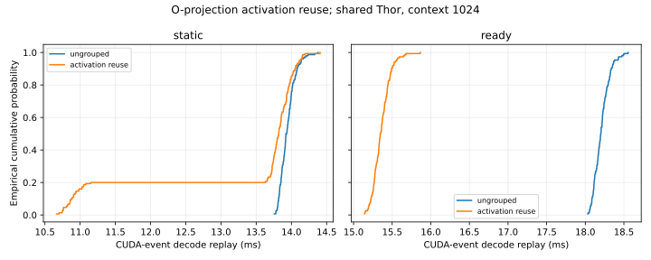

# Native O-projection activation reuse

| Backend / grouping | Checks | p50 ms | p95 ms | p99 ms | Batch p50 range ms |
|---|---:|---:|---:|---:|---:|
| baseline | 150 | 13.968 | 14.150 | 14.259 | 13.941–14.006 |
| static | 150 | 13.927 | 14.141 | 14.284 | 13.888–13.966 |
| static-reuse | 150 | 13.820 | 14.112 | 14.178 | 10.880–13.930 |
| ready | 150 | 18.201 | 18.374 | 18.496 | 18.162–18.218 |
| ready-reuse | 150 | 15.348 | 15.549 | 15.671 | 15.305–15.373 |

Five independently loaded batches per variant, five warmups and thirty checked samples each. A seeded Latin-square design balances order positions; ordered adjacent pairs are not fully balanced. Native batch-one BF16 Llama-3.2-1B-Instruct, context 1024, same-cache replay. Embedding, runtime, head and argmax are included; loading/prefill/cache restore/checking are excluded. The GPU has uncontrolled existing workloads, so these are cohort observations rather than isolated causal speedups.

- static: observed pooled median difference -0.77%; grouping uses the exact same native binary within this backend.
- ready: observed pooled median difference -15.67%; grouping uses the exact same native binary within this backend.

O-projection instructions fall from 2048 to 320 per decode; total tasks 3156 to 1428. Logical activation input loads fall from 8,388,608 to 1,310,720 bytes. This is not measured LPDDR traffic. All native output tiles and arithmetic are preserved. The static grouping pair both retire attention through the selected instruction join; the baseline row retains the previous no-retirement setting. This separates grouping from the handoff change.

Logits, final hidden state and newly appended K/V are bitwise identical in all nine context/seed pairs per backend (contexts 128/1024/8192, seeds 1/2/3). Both grouped backends also pass all three sanitizer tools. The earlier grouped static run without retirement failed racecheck and is excluded from this qualified cohort. These are frozen-input identity checks, not a claim of improved model quality.

- static grouped accumulated-native-cache check: **FAIL**, failed steps [10, 11, 21], worst logit NRMSE 3.0852%; 100/100 greedy matches. Numerical failures are not waived.
- ready grouped accumulated-native-cache check: **FAIL**, failed steps [10, 11, 21], worst logit NRMSE 3.0852%; 100/100 greedy matches. Numerical failures are not waived.

This is a host schedule/data-reuse specialization, not a precision change. It reduces instruction setup and changes task placement as well as activation loads; those effects are not isolated here. Final autoregressive/vLLM comparison remains separate. See `ACTIVATION_REUSE.md` for implementation, memory/progress contracts and reproduction.

