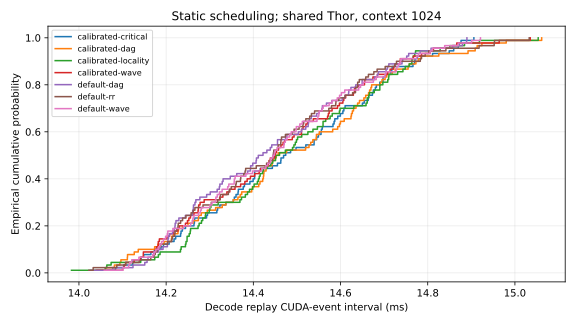

# Measured static scheduling on Thor

| Variant | Checks / samples | p50 ms | p95 ms | p99 ms | Batch p50 range ms |
|---|---:|---:|---:|---:|---:|
| default-dag | 90 | 14.417 | 14.796 | 14.889 | 14.403–14.447 |
| default-rr | 90 | 14.445 | 14.824 | 14.962 | 14.443–14.446 |
| default-wave | 90 | 14.447 | 14.808 | 14.903 | 14.332–14.480 |
| calibrated-wave | 90 | 14.449 | 14.810 | 14.972 | 14.419–14.478 |
| calibrated-dag | 90 | 14.455 | 14.901 | 14.989 | 14.414–14.571 |
| calibrated-locality | 90 | 14.456 | 14.803 | 14.933 | 14.422–14.499 |
| calibrated-critical | 90 | 14.472 | 14.855 | 14.880 | 14.462–14.507 |

All rows combine three independently loaded batches with five warmups and thirty checked samples per batch. Variant order is shuffled with seed 20261027. Native batch-one BF16 Llama-3.2-1B-Instruct, context 1024, same-cache replay; prefill/loading/cache restore and correctness checks are outside the CUDA-event interval. Embedding, runtime, head and argmax are included. The shared GPU is uncontrolled; no isolated or quality-matched speedup, energy or DRAM-traffic claim is made. Temporal numerical qualification remains open. These measurements do not select a default.

Measured-cost buckets come from inclusive maximum-consumer same-warp cycle spans. They contain waits and synchronization and are not pure compute costs. The critical policy prioritizes remaining modeled critical path. Locality only breaks equal estimated completion-time worker choices using producer affinity; activation buffers remain in global memory.

Serialized instruction queues are identical for calibrated-critical, calibrated-locality. Their latency differences reflect repeated-run variation, not different queue placement. The producer-affinity tie-break makes no placement change on this measured Llama DAG.
