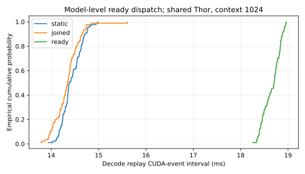

# Model-level native ready dispatch

| Mode | Checks/samples | p50 ms | p95 ms | p99 ms | Batch p50 range ms |
|---|---:|---:|---:|---:|---:|
| static | 90 | 14.386 | 14.769 | 14.950 | 14.355–14.432 |
| joined | 90 | 14.340 | 14.729 | 14.923 | 14.323–14.363 |
| ready | 90 | 18.706 | 18.920 | 18.953 | 18.633–18.760 |

Ready dispatch has +30.0% higher observed median than the ordinary static control in this cohort. The joined static control uses the same execution-role instruction join as ready dispatch while retaining its existing controller prefetch. Ready dispatch also adds CSR/atomic bookkeeping, workspace initialization and serialized controller dispatch. These observations do not isolate the cost of any one component.

Native batch-one BF16 Llama-3.2-1B-Instruct, context 1024, same-cache replay; three independently loaded batches, five warmups and thirty checked samples per batch, shuffled order with seed 71. Embedding/runtime/head/argmax are included; loading, prefill, cache restore and checks are excluded. Uncontrolled shared GPU load prevents an isolated causal speedup claim. Ready coverage is checked after every measured sample.

Ready accumulated-native-cache qualification: **FAIL**, failed steps [10, 11, 21]; worst logit NRMSE 3.0852%. All 100/100 greedy tokens agree. The failure reproduces the SIMT baseline; task coverage and memory-order evidence do not waive numerical limits.

Recommendation: retain ready dispatch as an opt-in prototype. The tested implementation is slower and does not justify replacing static queues. See `MODEL_READY_QUEUE.md` for memory/progress invariants, coverage and limitations.

