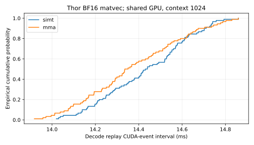

# Thor matvec: SIMT versus BF16 warp MMA

| Mode | Samples | p50 ms | p95 ms | p99 ms | Batch p50 range ms |
|---|---:|---:|---:|---:|---:|
| simt | 90 | 14.435 | 14.738 | 14.801 | 14.420–14.503 |
| mma | 90 | 14.343 | 14.771 | 14.833 | 14.286–14.445 |

Observed pooled median difference: -0.64%. These are context-1024 batch-one BF16 same-cache replays with matching weights and numerical/resource settings, five warmups and thirty checked samples in each of three batches. Embedding, runtime, head and argmax are included; loading, prefill, cache restoration and checking are excluded. Shared GPU load is uncontrolled. Seeded shuffling happened to put MMA before SIMT in each batch, leaving an order confound. The difference does not establish a controlled speedup.

MMA accumulated-cache numerical qualification: **FAIL**, 9/100 failed steps, worst logit NRMSE 4.0101%. Failed steps: [9, 10, 11, 21, 31, 32, 44, 88, 99]. Matching greedy tokens does not waive failures. The earlier SIMT baseline fails 3/100 steps; MMA fails more steps. No quality-matched generation speedup or default promotion is claimed.

The MMA candidate separately passes all three native sanitizer tools and 45 frozen-input checks across contexts 128/1024/8192 and seeds 1/2/3. See `TENSORCORE_MATVEC.md` for implementation, pilot, resources and reproduction.

